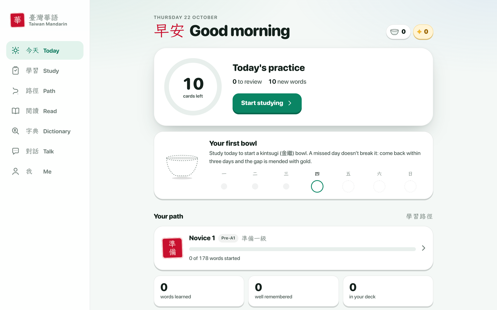
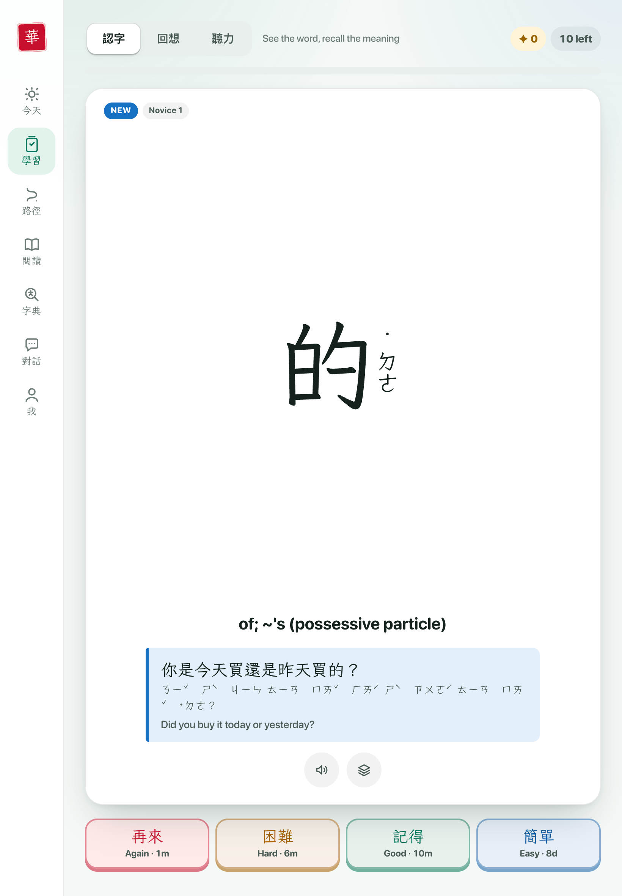
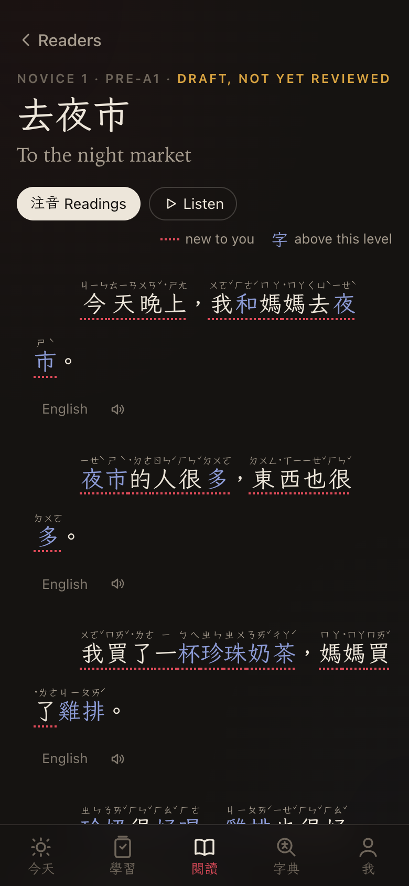
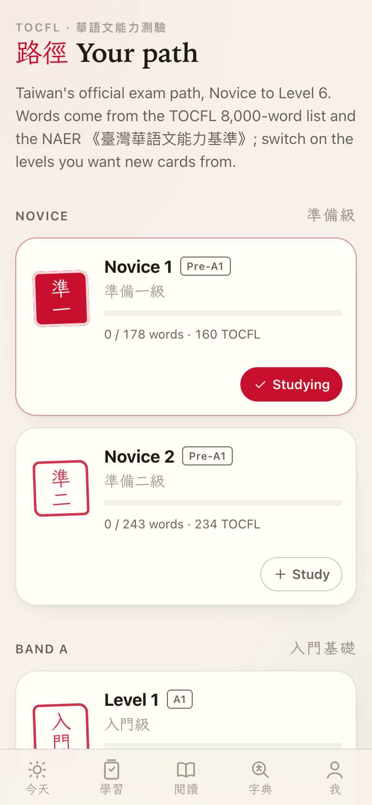
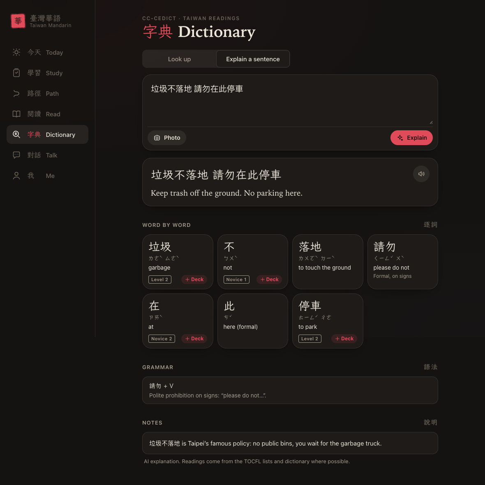
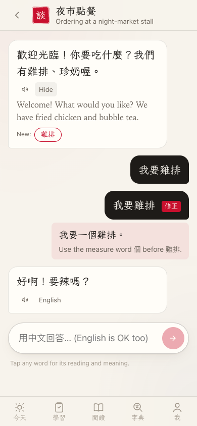
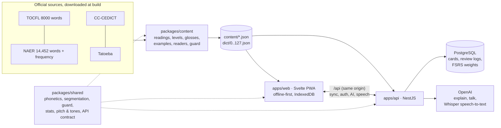

# 臺灣華語

Learn Taiwan Mandarin along Taiwan's official exam path. The app covers TOCFL Novice 1 → Level 6
(about 15,000 words) with Traditional characters, Zhuyin and Taiwan readings. It has:

- FSRS spaced repetition, with recognition, recall and listening modes
- a built-in dictionary (CC-CEDICT with Taiwan readings) where you can tap any character
- graded reading about Taiwan life
- example sentences, stroke order and stats

It is an offline-first PWA for phone, iPad and desktop, with an optional sync backend. The app speaks
**English, Vietnamese or Russian** (Tiếng Việt, Русский): menus, word meanings, example and reader
translations and the AI's replies all follow the language, and in Vietnamese words also show their
Sino-Vietnamese (Hán-Việt) reading (國家 quốc gia). See [Languages](#languages).

| Today                                        | Study (iPad)                                  | Reader (phone, dark)                         |
| -------------------------------------------- | --------------------------------------------- | -------------------------------------------- |
|  |      |  |
| **Path**                                     | **Explain a sentence**                        | **Talk**                                     |
|      |  |      |

## Architecture



On a phone the app has a bottom tab bar with six tabs (Today, Study, Talk, Read, Dictionary, Me)
that steps aside while the keyboard is up. On an iPad it becomes an icon rail with split views (word
list beside details, the reading text beside the dictionary panel). On a desktop it becomes a
labelled sidebar with keyboard shortcuts: `Space` reveals, `1`–`4` rate, `r` replays audio, `/`
opens search, and `g` then `t`/`s`/`p`/`c`/`r`/`d`/`m` navigates (`c` for conversation). Me holds progress and leads to the
account, settings, garden, levels and about pages. Every back button names where it goes (back to
the page you came from, or up to the parent after a deep link), and a level page can switch to any
other level without leaving it. A first visit lands on `/welcome`, where 墨, a drop of ink, walks the
TOCFL road as the page scrolls towards a Taiwan cherry (臺灣山櫻花) in a pot that puts out a branch of
hanging rose bells for every level and blooms in full at the end, when a white-eye (綠繡眼) drops in;
it sways, drops petals, and has a gold seam drawn down it (and sits down to say something when the
scrolling stops). After that 墨 comes along through the app: it sits in a corner of every page (on
Study, on the progress bar), says a word about where you are, and arrives in a way that fits the
move, close to its corner: it steps over between tabs, comes down a short rope into a deeper page,
and climbs up one when you go back. It can be turned off in Settings (per device).

## Layout

```
apps/web          Svelte 5 + Vite PWA (works fully offline, no account needed)
apps/api          NestJS API (auth, content, sync), PostgreSQL
packages/shared   phonetics (pinyin ⇄ Zhuyin), segmentation, content types, Taiwan-standard guard
packages/content  content pipeline: word lists + CC-CEDICT + Tatoeba → app content files
data/             curated inputs: readers, AI-written glosses/examples, stroke-order overrides
```

Web and Vitest import `@taiwan-mandarin/shared` from source (the `source` export condition), so
edits hot-reload. The API uses its built `dist/`. Root scripts build it first.

## Commands

```sh
npm install
cp .env.example .env                       # Postgres credentials for docker compose
cp apps/api/.env.example apps/api/.env
npm run dev        # builds content on first run, then Postgres + shared watch + API :3000 + web :5173
npm test           # shared, content and web tests, then the Taiwan-standard guard
npm run check      # tsc + svelte-check in every workspace
npm run lint       # ESLint (no `any`)
npm run build      # shared → api → web (service worker included)
npm run content    # re-download the sources and rebuild the app content
```

Web-only: `npm run icons -w @taiwan-mandarin/web` regenerates the PWA icons from `public/icon.svg`.

### Deploy

```sh
cp .env.example .env    # set JWT_SECRET (openssl rand -base64 48), POSTGRES_PASSWORD, WEB_ORIGIN, optional API keys
docker compose --profile app up -d --build
```

One image build downloads the sources, builds the content, the API and the PWA. nginx serves the
app on `WEB_PORT` (8080) and proxies `/api` to the API, so everything is one origin. The API runs
migrations on start. Put TLS in front, for example a reverse proxy or a tunnel; the PWA, the
microphone and secure cookies need HTTPS on a real domain. With such a proxy in front of nginx, set
`TRUST_PROXY=2` so rate limits see each learner's address rather than the proxy's. PostgreSQL
listens only on 127.0.0.1; nginx sends security headers (CSP and others) with the app. Then open
it on the iPhone or iPad and choose Share › Add to Home Screen.

#### Backups

The `backup` service dumps the database into `./backups` when it starts and then every
`BACKUP_INTERVAL_HOURS` (24), and deletes dumps older than `BACKUP_KEEP_DAYS` (14) after each new
one succeeds. Dumps hold emails and password hashes, so they are readable by their owner only.
The service shows as unhealthy in `docker compose ps` when the newest dump is older than two
intervals.

```sh
docker compose --profile app run --rm backup now    # a dump right now, e.g. before an upgrade
deploy/restore.sh backups/taiwan_mandarin-20261022-040000.dump
```

`restore.sh` asks first, stops the API, replaces the database with the dump in one transaction (a
failure leaves it as it was) and starts the API again. A copy on the same disk doesn't survive
losing the machine: also copy `./backups` somewhere else, e.g. with a nightly `rsync` or `rclone`.

CI (`.github/workflows/ci.yml`) runs content build, type checks, lint, all tests (with a
PostgreSQL service) and the production builds.

**More example sentences.** `npm run examples -w @taiwan-mandarin/content -- --levels L3,L4`
writes Taiwan-style sentences for words without one, with OpenAI (`OPENAI_API_KEY` from
`apps/api/.env`; model `--model` / `OPENAI_EXAMPLES_MODEL` / `OPENAI_MODEL`, effort `--effort` /
`OPENAI_EXAMPLES_EFFORT`, default `medium`). Each
result is validated (contains the word, passes the guard) and appended to
`data/generated/examples-ai.jsonl`; then rebuild the content.

## Streak, ink and seals

- **Streak plant (梅, with 金繼 kintsugi).** Every day with a review waters a plum tree in a celadon
  pot. It sprouts on day one, becomes a small tree at 7 days, buds at 30 and blooms at 100. Missing
  a day breaks nothing: come back within three days and the crack in the pot is mended with a gold
  seam, and the count goes on. After a longer break the plant moves to your garden (Me), gold and
  all, and a new seed is planted. Logic: `packages/shared/src/kintsugi.ts`; drawing:
  `apps/web/src/lib/plant-art.ts`.
- **Ink (墨, the app's XP).** Drops of gold ink (泥金): 10 per answer and 5 more for a new
  word, the same for every grade, so honest grading never costs anything. Practice away from the
  cards counts too: 50 for a story read to the end, 10 for each message sent in Talk and each
  character written in the stroke writer. The same story or character counts once a day. These go
  in their own append-only practice log (synced like the review log); they add ink but don't
  water the plant, which still needs a review.
- **Seals (印譜).** Nine milestones (first gold seam, buds at 30 days, 1,000 words…).
- All of it comes from practice totals per day (`packages/shared/src/activity.ts`). Signed in,
  sync returns those totals for every device in the learner's time zone, so phone, iPad and
  laptop show the same plant.
- Sound effects (Web Audio, no files) and vibration (Android) are on by default and can be
  switched off per device in Me › Settings. Everything moves with springs, and nothing moves
  under the system's reduced-motion setting.

## API and sync

The web app works fully offline without an account. Signing in (Me › Account) syncs progress
between devices.

- **Accounts.** Passwords use argon2id. Access is a 15-minute JWT held in memory. A rotating
  refresh token sits in an httpOnly cookie, and reusing a rotated token revokes the whole chain.
  Changing the password (Me › Account) signs out every other device, and "Sign out everywhere"
  ends every session; access tokens issued before either stop working at once.
- **Updates.** A new version of the app downloads in the background and waits for the learner to
  tap Reload, so it never swaps the app out mid-answer.
- **Same origin.** The web app calls the API under `/api` (Vite proxies it in development), so
  the cookie stays first-party. That matters for Safari on iPhone and iPad.
- **Sync** (`POST /v1/sync`): cards merge last-write-wins per word, review logs are append-only
  and keyed by client UUIDs, and deck and settings are whole-value last-write-wins. Practice
  totals per day come back for the days that changed (`activity`). It runs on
  start, when the app becomes visible, 5 s after changes, and on sign-in. The first sign-in on a
  device merges its local progress into the account.
- **Personal FSRS.** Review logs live in PostgreSQL. The fsrs-rs optimizer
  (`@open-spaced-repetition/binding`) fits each learner's weights nightly, once they have 400
  new reviews, or on demand from Me. Clients receive the weights on their next sync.
- **Public API.** Swagger is at `/docs` (`/api/docs` through the web app). Content routes are
  open: `/v1/levels`, `/v1/words`, `/v1/dict/:q`, `/v1/segment`, `/v1/readers`. Personal routes
  (`/v1/me/stats`, `/cards`, `/reviews`, `POST /v1/me/deck/:wordId`) accept a personal access
  token (`tm_…`) created in Me › API access. Tokens reach only those four routes: they can't
  sync, use AI or speech, manage tokens or delete the account.
- **Content.** The API serves words and the dictionary from the same generated files as the
  web app, held in memory. The database holds only learner data.

### AI features (sign-in required)

These run on the server with OpenAI (`OPENAI_API_KEY`, which also powers speech-to-text). Every
setting lives in `apps/api/.env` (or the environment in Docker); an empty value means "default".

| Variable                                        | Default                | What it does                                                           |
| ----------------------------------------------- | ---------------------- | ---------------------------------------------------------------------- |
| `OPENAI_MODEL`                                  | `gpt-6-luna`           | Model for explain and conversation                                     |
| `OPENAI_REASONING_EFFORT`                       | `low`                  | `none`, `minimal`, `low`, `medium`, `high`, `xhigh` or `max`           |
| `OPENAI_EXPLAIN_MODEL`, `OPENAI_EXPLAIN_EFFORT` | the two above          | Explain a sentence only                                                |
| `OPENAI_TALK_MODEL`, `OPENAI_TALK_EFFORT`       | `OPENAI_MODEL`, `none` | Conversation only                                                      |
| `OPENAI_TRANSCRIBE_MODEL`                       | `whisper-1`            | Pronunciation check (whisper-1 gives word timestamps)                  |
| `OPENAI_SERVICE_TIER`                           | `auto`                 | `priority` answers faster at a higher price, `flex` slower and cheaper |
| `OPENAI_VERBOSITY`                              | (not sent)             | `low`, `medium` or `high`                                              |
| `OPENAI_TIMEOUT_MS`, `OPENAI_MAX_RETRIES`       | `45000`, `1`           | Raise the timeout for slow settings (gpt-5 at medium effort)           |
| `AI_DAILY_LIMIT`, `SPEECH_DAILY_LIMIT`          | `200`, `300`           | Requests per user per day                                              |

- Answers use the Responses API with structured outputs, validated against zod schemas. Nothing
  is stored on OpenAI's side (`store: false`), and prompts are laid out so repeated parts are
  cached.
- Not every model accepts every effort (gpt-6.1-sol and gpt-6-astra reject `none`): the API then
  retries once with the nearest one and logs which variable to change.
- The API logs one line per call, the place to look when something feels slow, e.g.
  `explain gpt-6-luna effort=low · 3.42 s (first output 0.91 s) · in 1,104 (cached 1,024) · out 1,380 (reasoning 210)`.
  The startup log shows the settings in use.

**Explain a sentence** (Dictionary › Explain): text or a photo of a sign, menu or message. You
get a translation, a word-by-word breakdown, grammar and usage notes, streamed as they are
written (`POST /v1/ai/explain/stream`, NDJSON: the translation first, then each word). Typed
text is taken as it is; the model only transcribes photos. Readings are then replaced with the
path's or dictionary's Taiwan readings. When the model's reading matches none of ours (垃圾 lājī),
ours wins, and Mainland character readings are fixed for words we don't have. Tokens link to the
path for one-tap "add to deck".

**Talk** (conversation practice): eight Taiwan situations (night-market stall, bubble tea, MRT,
7-Eleven, clinic…).

- The partner may only use the learner's vocabulary: synced cards, Novice 1, and the levels below
  their path.
- Each reply (and each correction) is split into words and checked. More than two unknown words,
  or Mainland wording, triggers one rewrite: the model sees its first attempt and what to change.
- Remaining unknown words are returned as "new words" to tap.
- The learner's messages get a 修正 correction when needed.

### Pronunciation check (sign-in required)

Record a word or sentence on its word page. The browser decodes the recording (AAC on Safari,
Opus on Chrome) to 16 kHz mono WAV, so the server needs no ffmpeg.

- **Syllables.** Speech-to-text (`OPENAI_TRANSCRIBE_MODEL`, default `whisper-1` with word
  timestamps) transcribes the recording. The prompt never contains the target, so the check
  reports what was said rather than what was expected. Silence and readings that don't fit are
  turned away before the paid call. The output is converted to Taiwan characters and aligned
  with the target by edit distance. Homophones count as correct sounds.
- **Tones.** `packages/shared/src/pronunciation` (pure TypeScript, tested on synthetic voices) runs
  a YIN F0 tracker and converts pitch to semitones in the speaker's own range. It then matches
  each syllable's contour against templates for the four tones.
- **Sandhi.** Expected tones are computed first (3-3 → 2-3, 不 → bú before a 4th tone, 一 → yí/yì),
  so correct sandhi is never marked wrong.
- **Display.** The app draws your pitch curve over the ideal tone shape and says what it heard
  ("Sounded 4th, needs 3rd"). Tone feedback is labelled approximate.

```sh
npm run db:up                                  # PostgreSQL in Docker (POSTGRES_PORT in .env)
npm run db:migrate -w @taiwan-mandarin/api     # apply migrations
npm run test:api                               # API end-to-end tests (separate *_test database)
```

## Content

`npm run content` downloads the sources into `data/raw/` (gitignored) and writes
`apps/web/public/content/` (word lists per level, readers, search index) and
`apps/web/public/dict/` (128 dictionary shards). A tap loads only the shard for the tapped
character. The service worker caches every file after first use.

| Source                                              | Used for                                                              |
| --------------------------------------------------- | --------------------------------------------------------------------- |
| TOCFL 《華語八千詞表》 (SC-TOP, 2024-09)            | Levels Novice 1 – Level 5 (7,517 entries), readings, parts of speech  |
| NAER 《臺灣華語文能力基準》三等七級詞語表 (2025-04) | Level 6 (精通, C2: TOCFL has no list), extra words, Zhuyin, topics    |
| NAER 通用詞頻表                                     | Study order within a level                                            |
| [CC-CEDICT](https://cc-cedict.org)                  | English glosses, measure words, the dictionary                        |
| CVDICT (Phong Phan, CC BY-SA 4.0)                   | Vietnamese glosses and dictionary: CC-CEDICT translated line by line  |
| [Tatoeba](https://tatoeba.org)                      | Example sentences with English translations                           |
| `data/generated/*.jsonl`                            | Glosses and examples written for this app where the sources have none |
| `packages/shared/src/content/curated.ts`            | The original 121 hand-checked words: notes, Mainland labels           |

How the path is built (`packages/content/src/lexicon.ts`):

- **Levels.** A word's level is its TOCFL band. The two lists line up level by level (the TOCFL
  list's 2022 notes map them): NAER 第1級 ≈ 準備一級 … 第6級 ≈ 流利級, and 第7級 becomes Level 6.
  NAER-only words fill gaps after the TOCFL words of their level.
- **Readings.** NAER's syllable-split Zhuyin is used where the forms match. Otherwise the run-together
  TOCFL pinyin is split by a DP that checks each syllable against the character's known readings.
  NAER's tones win for multi-character words; the differences are listed in
  `data/generated/reading-diffs.txt` for review. 一 and 不 keep citation tones (the app applies
  sandhi).
- **Headwords.** Variants in a list cell (`爸爸/爸`, `小孩(子)`, `台灣/臺灣`) become one word. The
  headword is the Taiwan-standard form (臺 over 台, no erhua when a non-兒 form exists).
- **Glosses.** CC-CEDICT senses for the same headword and reading, shortened for flashcards. The
  full entry stays in the dictionary.

**Graded readers** live in `data/readers/<id>.json`. There are 24 texts, 3 per level, about Taiwan
life. They were written with AI and carry `"draft": true` (shown as "Draft") until a person
has reviewed them. The build:

- splits each text into words with readings;
- links the words to the path;
- glosses every word above the reader's level (from the reader's `glossary`, else the study gloss);
- reports those words in `data/generated/reader-hard-words.tsv`.

Generated content isn't committed. The NAER list is marked 版權所有, and the TOCFL list states no
license. Both are downloaded from their official sites at build time, and attributed in the app's
About section and in `NOTICE`.

## Languages

The interface is in typed catalogs, `apps/web/src/lib/i18n/en.ts`, `vi.ts` and `ru.ts` (same keys,
checked by svelte-check and a test; words after numbers take each language's plural forms through
`plural.ts`). Chinese stays in the components. The language is a synced setting, `language`; a
first visit follows the browser, and the welcome page and Settings switch it. In development,
`?lang=vi` or `?lang=ru` shows that language without changing settings.

Content has a set of files per language (`packages/content/src/languages.ts`). English is
`content/` and `dict/`; Vietnamese is `content/vi/` and `dict/vi/`, the same files with Vietnamese
added (`vi`, `viSource`, `twVi`, `hv` on words, `vi` on examples and readers, `gv` on reader words,
Vietnamese definitions in the dictionary with `en: 1` where CVDICT has none); Russian is
`content/ru/` and `dict/ru/` likewise (`ru`, `ruSource`, `twRu`, `gr`). A learner loads one set, so
English learners download nothing extra. Where a translation is missing, the English shows with a
small EN tag.

### Vietnamese

- **Meanings** come from CVDICT, CC-CEDICT translated into Vietnamese line by line (122,591
  entries, CC BY-SA 4.0). Its own repository is gone, so `fetch` downloads the unchanged 1.0.1 file
  kept in another project, pinned to a commit and checked against its SHA-256. The build glosses
  each word from the same entries as its English. About 97% of the path has one; the rest, and the
  121 curated words, are written by hand or with AI.
- **Readers** carry a hand-written `vi` block (title, summary, translation, glossary).
- **Examples, gap glosses and Hán-Việt readings** are written with OpenAI:
  `npm run translate -w @taiwan-mandarin/content -- --lang vi --only examples|hanviet|glosses` (after a
  build; `--limit 100` writes a sample first). See `data/generated/README.md`.

### Russian

There is no openly licensed Chinese–Russian dictionary, so:

- **Meanings** of the 121 curated words are written by hand, and those of the rest of the path
  with OpenAI (`npm run translate -w @taiwan-mandarin/content -- --lang ru --only glosses`),
  translated from the Chinese with the word's English gloss and CC-CEDICT senses as a reference.
  In the dictionary a study word's own entry shows its Russian meaning; other entries stay English.
- **Examples** are translated with OpenAI too (`--only examples`).
- **Readers** carry a `ru` block written for the app (title, summary, translation, glossary).
  Its glossary also covers the glossed words outside the study path, which have no Russian
  definitions to fall back on.
- Search reads Russian as a meaning, never as pinyin, and matches ё and е either way.

### Both

- **AI features** take the language with each request: Explain and Talk answer, gloss and correct
  in it. API errors carry a code that the app shows in the learner's language.

Existing checkouts need the new source once: `npm run content` (or `npm run fetch -w
@taiwan-mandarin/content`); `content:ensure` rebuilds content that predates one of the languages.

## Taiwan standard (臺灣華語)

This app teaches Taiwan Mandarin only. Every Chinese string is Traditional Chinese in Taiwan
forms (zh-Hant-TW), with Taiwan vocabulary and Taiwan readings. Zhuyin is the primary phonetic
system; pinyin is optional.

- **Script.** Taiwan forms only (裡, 為, 線…). 臺 is used in formal names (臺灣, 臺北). The everyday
  form 台 appears only in notes that explain it, and is a listed variant.
- **Vocabulary.** Taiwan words (捷運, 計程車, 腳踏車, 機車, 網路…). Mainland words that the NAER list
  includes for recognition (地鐵, 自行車) carry a note with the Taiwan word and come last in their
  level.
- **Readings.** From the official lists, which follow the MOE 《重編國語辭典修訂本》 (垃圾 lèsè,
  星期 xīngqí, 誰 shéi). Dictionary entries outside the path get CC-CEDICT's "Taiwan pr." readings
  and the per-character fixes below.
- **Glyphs.** Chinese text is tagged `lang="zh-Hant-TW"` and uses Taiwan-locale fonts (LXGW
  WenKai TC, PingFang TC / Noto Sans TC).

### Automated guards

`npm test` and the content build run both checks. `npm run guard:taiwan` runs the repo scan alone.

1. **Text guard** (`packages/shared/src/taiwan-standard`). It checks:
   - every example sentence, reader and note;
   - our own glosses;
   - curated headwords;
   - every Chinese run in `apps/web` and `apps/api` sources.

   Each text goes through three checks:
   - OpenCC `{ from: 'cn', to: 'twp' }` (Simplified characters plus Mainland phrasing). The text
     must come back unchanged. Everyday words that OpenCC's table rewrites into software terms
     (消息 → 訊息, 打開 → 開啟, 支持 → 支援, 項目 → 專案…) are ignored (`OPENCC_OVERREACH`).
   - A denylist of Mainland words OpenCC misses when they are written in Traditional characters
     (地鐵, 出租車, 公交車, 空調, 便利店, 摩托車, 菠蘿, 質量…).
   - Labeled `mainland` notes, which are checked for characters only.

   Headwords from the official lists and CC-CEDICT reference glosses are not phrase-checked: the
   lists define the standard. False positives go in `allowlist.ts`, scoped to one location, with
   a reason.

2. **Reading guard.** Mainland readings must never appear: 垃圾 la1 ji1, 期 qi1, 危 wei1, 企 qi3,
   暫 zan4, 綜 zong1, 究 jiu1, 髮 fa4. (液 yè is accepted: it is an MOE alternate reading and both
   lists use it.) The dictionary build rewrites these to the Taiwan reading.

### Stroke order

`hanzi-writer-data` ([Make Me a Hanzi](https://github.com/skishore/makemeahanzi)) follows PRC
stroke order and is loaded per character from jsDelivr (cached for offline use).
`data/stroke-order-tw-overrides.json` lists characters verified against the MOE
《常用國字標準字體筆順學習網》, either as `same-as-prc` or with corrected Taiwan stroke data (`tw`).
`npm run strokes -w @taiwan-mandarin/web` bundles those into `public/strokes-tw.json`. Every
other character shows the badge 「筆順可能與臺灣標準不同」. Stroke data is never invented: entries
need a source.
